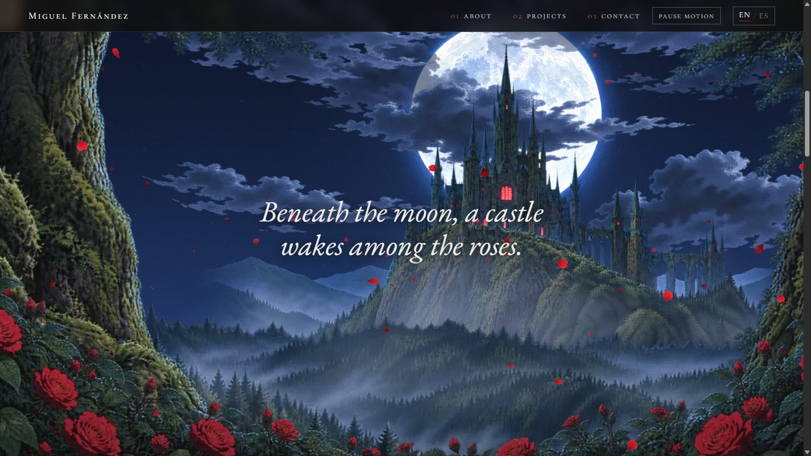
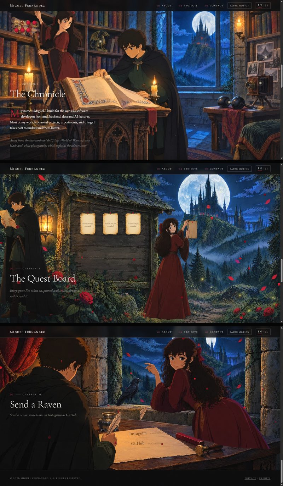

<div align="center">

# Miguel Fernández

**A portfolio you step into, like an animated film.**

A full moon, a gothic castle rising beneath it, and a story told in three painted scenes,<br>
painted in the style of a 1990s animated feature and brought to life in your browser.


**[Visit the site →](https://miguelfdzportfolio.pages.dev/)**

[GitHub](https://github.com/miguelfdz014) · [Instagram](https://www.instagram.com/miguelfdz014/)

</div>

---

## The journey

The page is one continuous scroll. Each section is a scene, and scenes hand over to each other through a veil of mist:

| | Section | What you see |
|---|---|---|
| I | **Hero** | The moon alone in a starry sky, clouds drifting across it, the castle's spires just peeking in. |
| II | **Descent** | The castle rises beneath the moon; mossy trees close in like curtains and wild roses grow up from below. |
| III | **The Chronicle** | A candlelit tower library, animated: one reader turns the pages, the other pulls a sealed scroll from the shelf. Each certification is a scroll, open or sealed. |
| IV | **The Quest Board** | A forest notice board by lantern light. Every project is a parchment pinned with a dagger and a wax seal. |
| V | **Send a Raven** | A writing desk in the tower. The links are written on the letter; use one and the raven carries it off toward the moon. |



## Painted, then brought to life

The artwork is generated with [Higgsfield](https://higgsfield.ai) (AI image and video models), painted as separate layers, and animated in code with Three.js:

- **Layers with depth**: sky, moon, clouds, castle, mist, forest, trees and roses each move at their own speed as you scroll, and tilt gently with the mouse.
- **Everything moves**: clouds drift, stars twinkle, mist rolls through the valley, roses and branches sway in passing gusts, petals fall, and candles, lanterns and castle windows flicker.
- **The library** is a seamless video loop with a locked-off camera, so its clickable scrolls and objects stay in place.
- **The raven** is a hand-timed sprite animation: it waits, takes the sealed letter, and flies off toward the moon.
- **Real HTML on top**: every parchment, scroll and link is an ordinary, keyboard-reachable element laid over the art, not a picture of one.



## Built with

[Three.js](https://threejs.org) · [Vite](https://vite.dev) · vanilla JavaScript and CSS · Cormorant and EB Garamond · artwork by [Higgsfield](https://higgsfield.ai) · hosted on Cloudflare Pages

- **Bilingual**: English and Spanish, switchable at any time.
- **Private**: no cookies, no analytics, no trackers, and no requests to any third party. Even the fonts are self-hosted.
- **Accessible**: WCAG AA contrast, full keyboard support, a *Pause motion* button, and a still view for anyone who asks their system for reduced motion. Lighthouse scores 100 for accessibility, best practices and SEO.
- **Locked down**: a strict Content-Security-Policy that allows nothing but the site's own files.

## Run it locally

Requires Node.js 18 or later.

```bash
npm install
npm run dev       # dev server at http://localhost:5173
npm run build     # production build into dist/
npm run preview   # serve the build with the production security headers
npm test          # unit tests (Vitest)
```

## Make it yours to edit

| To change | Edit |
|---|---|
| Name, links, projects (parchments), certifications (scrolls) | `src/config.js`. Set a project's `status` to `'ready'` and add its details (example in the file). |
| Any text, in both languages | `src/i18n.js` |
| Colors and fonts | the variables at the top of `src/styles/main.css` |
| The scenes | `src/scene/stages/`: `landscape.js`, `library.js`, `board.js`, `desk.js` (layers, positions, motion). Shared code: `stage.js`, `materials.js`, `director.js`, `world.js` |
| Where clickable things sit on the art | `src/art/hotspots.json` (positions as fractions of each painting) |
| The artwork | Paint new layers, put the PNGs in `<masters>/<scene>/<layer>.png`, then run `npm run art -- <masters>` to write the WebP files into `src/art/`. `npm run art -- --budget dist` checks the download size after a build. |

After adding or upgrading a dependency, run `npm run notices` to refresh the third-party licence file.

## Deployment

Cloudflare Pages builds every push to `main` (build command `npm run build`, output directory `dist`). Security headers live in `public/_headers`.

Keep Cloudflare features that inject scripts **off**: Web Analytics auto-injection, Rocket Loader, Email Obfuscation and Zaraz. The Content-Security-Policy would block them, and they would break the site's no-tracking promise.

## License

© 2026 Miguel Fernández. **All rights reserved.** The code is public to read, not to reuse; see [`LICENSE`](LICENSE). Bundled open-source software and fonts keep their own licences, listed in [`public/third-party-notices.txt`](public/third-party-notices.txt).
