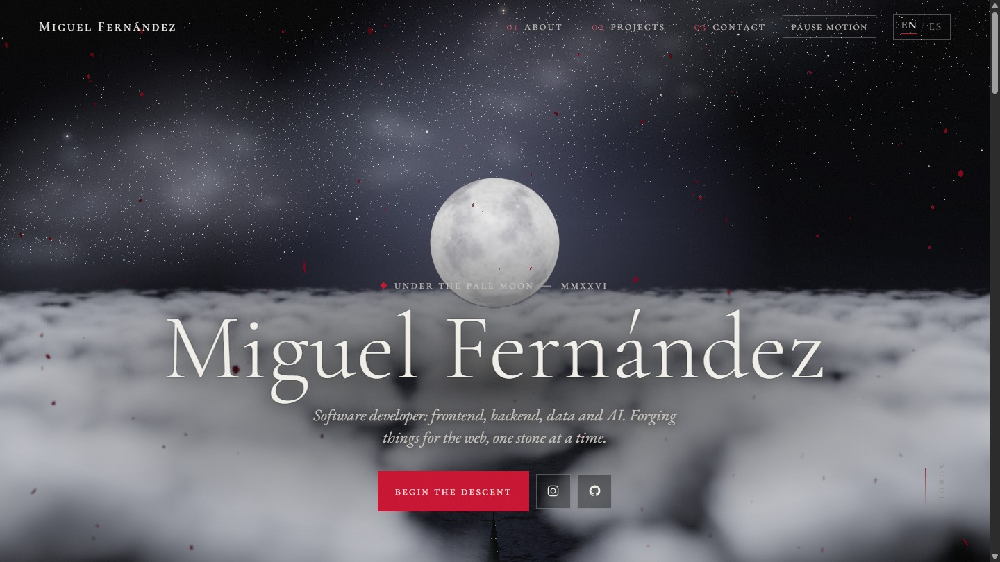
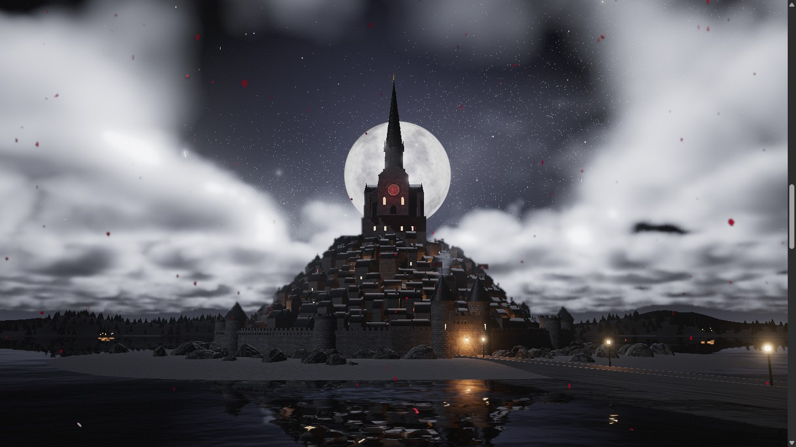
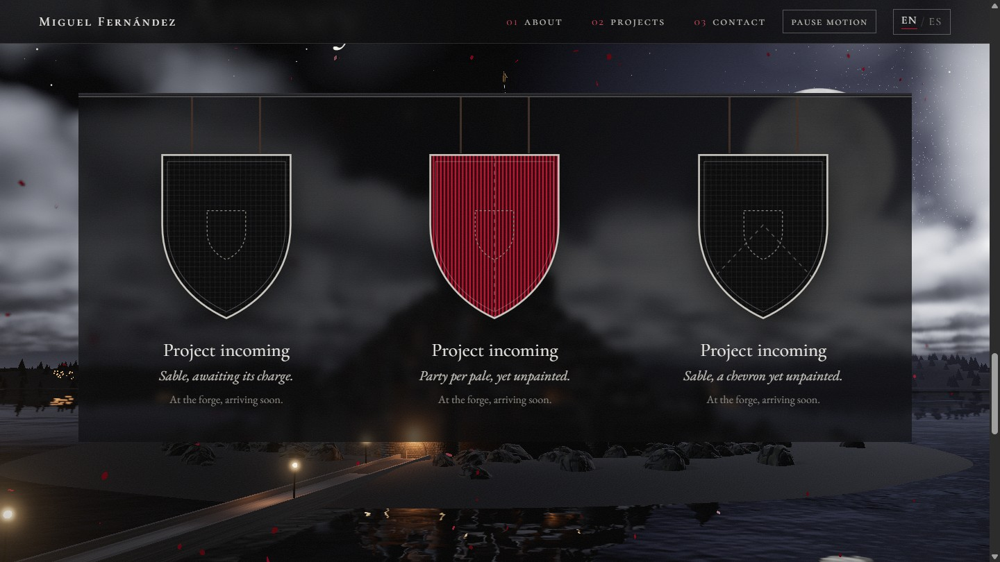

<div align="center">

# Miguel Fernández

**A portfolio you descend into.**

Scroll from a full moon above a sea of clouds, down through them,<br>
to Mont-Saint-Michel rising from a moonlit bay, all rendered live in your browser.



[GitHub](https://github.com/miguelfdz014) · [Instagram](https://www.instagram.com/miguelfdz014/)

</div>

---

## The descent

The whole page is one continuous camera move. Each section of the site is a stop on the journey:

| | Section | What you see |
|---|---|---|
| I | **Hero** | Above the clouds. The full moon, the Milky Way, the odd shooting star. |
| II | **Descent** | The camera sinks into the cloud deck, and the abbey spire breaks through first. |
| III | **The Chronicle** | Below the clouds, the clouds part: Mont-Saint-Michel, the moon behind its spire, both mirrored in the bay. |
| IV | **The Armory** | A glide across the water along the lamp-lit causeway toward the gate. |
| V | **Send a Raven** | Up the rock toward the spire and the golden archangel. |



## Made from code, not models

There are no downloaded 3D models or image textures. Everything you see is generated when the page loads:

- **Volumetric clouds**: a raymarched cloud deck lit by the moon, with silver edges, shadowed undersides, and a clearing that opens over the island as you come down.
- **Mont-Saint-Michel**: granite rock, ramparts and towers, a gatehouse with its portcullis raised, a village of a few hundred houses with chimney smoke and lit windows, and the abbey with flying buttresses, a stained-glass rose window and the spire.
- **The bay**: real-time reflections on moving water, tidal sandbanks, boulders, and a horizon of hills, woods and distant village lights.
- **The night sky**: a lunar surface with maria, craters and ray systems; colored, twinkling stars; and the Milky Way.
- **Every surface** (masonry, slate, granite, wet sand, woven banners) is painted procedurally, in parallel Web Workers so the page never freezes.

## The Armory

In heraldry, *armory* means coats of arms, so each project hangs as a shield. Unfinished work stays a blank shield with its heraldic description. Hovering over a shield paints it with *gules*, the engraver's vertical-line pattern for red.



## Built with

[Three.js](https://threejs.org) · [Vite](https://vite.dev) · vanilla JavaScript and CSS · Cormorant and EB Garamond · hosted on Cloudflare Pages

- **Bilingual**: English and Spanish, switchable at any time.
- **Private**: no cookies, no analytics, no trackers, and no requests to any third party. Even the fonts are self-hosted.
- **Accessible**: WCAG AA contrast, full keyboard support, a *Pause motion* button, and a still view for anyone who asks their system for reduced motion. Lighthouse scores 100 for accessibility, best practices and SEO.
- **Locked down**: a strict Content-Security-Policy that allows nothing but the site's own files.

## Run it locally

Requires Node.js 18 or later.

```bash
npm install
npm run dev       # dev server at http://localhost:5173
npm run build     # production build into dist/
npm run preview   # serve the build with the production security headers
```

## Make it yours to edit

| To change | Edit |
|---|---|
| Name, links, projects (shields) | `src/config.js`. Set a project's `status` to `'ready'` and add its details (example in the file). |
| Any text, in both languages | `src/i18n.js` |
| Colors and fonts | the variables at the top of `src/styles/main.css` |
| The 3D world | `src/scene/`: `world.js` (camera path, lights, water, moon), `mount.js` (the island), `terrain.js` (bay, causeway, horizon), `clouds.js`, `sky.js`, `gen.js` (generated textures) |

After adding or upgrading a dependency, run `npm run notices` to refresh the third-party licence file.

## Deployment

Cloudflare Pages builds every push to `main` (build command `npm run build`, output directory `dist`). Security headers live in `public/_headers`.

Keep Cloudflare features that inject scripts **off**: Web Analytics auto-injection, Rocket Loader, Email Obfuscation and Zaraz. The Content-Security-Policy would block them, and they would break the site's no-tracking promise.

## License

© 2026 Miguel Fernández. **All rights reserved.** The code is public to read, not to reuse; see [`LICENSE`](LICENSE). Bundled open-source software and fonts keep their own licences, listed in [`public/third-party-notices.txt`](public/third-party-notices.txt).
