<p align="center">
  
</p>

<p align="center">
  <b><a href="https://miguelfdzportfolio.pages.dev/">Enter the castle →</a></b><br>
  <sub><a href="https://github.com/miguelfdz014">GitHub</a> · <a href="https://www.instagram.com/miguelfdz014/">Instagram</a></sub>
</p>

<p align="center"></p>

## The journey

<p align="center">
  
</p>

The page is one continuous scroll, told as a story. Each section is a scene, and the scenes hand over to each other through a veil of mist.

| | Scene | What you find there |
|:-:|---|---|
| **I** | **The moon** | The moon alone in a starry sky, with clouds drifting across it and the castle's spires just peeking in. |
| **II** | **The castle** | The castle rises beneath the moon. Mossy trees close in like curtains, and wild roses grow up from below. |
| **III** | **The Chronicle** | A candlelit tower library. A writer works at the lectern while a girl watches from the window. The book opens a parchment with the stack, the scroll rack holds the certifications, and the hobbies are hidden in the room. |
| **IV** | **The Quest Board** | A forest notice board by lantern light, with two archers reading their quests. Every project is a parchment pinned with a dagger and a wax seal. |
| **V** | **Send a Raven** | A writing desk in the tower. The links are written on the letter, and when you use one, the raven carries it off toward the moon. |

<p align="center"></p>

## Painted, then brought to life

<p align="center">
  
</p>

The artwork is generated with [Higgsfield](https://higgsfield.ai) (AI image and video models) and brought to life in code with Three.js:

- **Depth in the opening.** Sky, moon, clouds, castle, mist, forest, trees and roses are separate layers. Each moves at its own speed as you scroll and tilts gently with the mouse.
- **One painting per chapter.** The library, the quest board and the desk are each a single painting with the characters painted in, plus a tall version made for phones, so nothing is cropped or pasted.
- **Everything moves.** Clouds drift, stars twinkle, mist rolls through the valley, petals fall, and candles, lanterns and castle windows flicker.
- **The library** is a seamless video loop with a locked-off camera, so its clickable scrolls and objects stay in place.
- **The raven** is a hand-timed sprite animation: it waits, takes the sealed letter, and flies off toward the moon.
- **Real HTML on top.** Every parchment, scroll and link is an ordinary, keyboard-reachable element laid over the art, not a picture of one.
- **Optional music.** A quiet night loop, off until you turn it on. It is only downloaded when you do.

<p align="center"></p>

## Built with

<p align="center">
  
</p>

Vanilla JavaScript and CSS, no framework. Set in Cormorant and EB Garamond.

- **Bilingual:** English and Spanish, switchable at any time.
- **Private:** no cookies, no analytics, no trackers, and no requests to any third party. Even the fonts and the music are self-hosted.
- **Accessible:** WCAG AA contrast, full keyboard support, a *Pause motion* button, and a still view for anyone whose system asks for reduced motion.
- **Locked down:** a strict Content-Security-Policy that allows nothing but the site's own files.
- **Checked:** every pull request runs the tests, a production build and a download-size budget before it can be merged.

## Run it locally

Requires Node.js 22.12 or later.

```bash
npm install
npm run dev       # dev server at http://localhost:5173
npm run build     # production build into dist/
npm run preview   # serve the build with the production security headers
npm test          # unit tests (Vitest)
```

## Make it yours to edit

| To change | Edit |
|---|---|
| Name, links, projects (parchments), certifications (scrolls) | `src/config.js`. Set a project's `status` to `'ready'` and add its details (example in the file). |
| Any text, in both languages | `src/i18n.js` |
| Colors and fonts | the variables at the top of `src/styles/main.css` |
| The scenes | `src/scene/stages/`: `landscape.js`, `library.js`, `board.js`, `desk.js` (layers, positions, motion). Shared code: `stage.js`, `materials.js`, `director.js`, `world.js` |
| Where clickable things sit on the art | `src/art/hotspots.json` (positions as fractions of each painting, one set for the 16:9 painting and one for the phone painting) |
| The artwork | Put the PNG masters in `<masters>/<scene>/<layer>.png` (phone versions end in `-portrait`), then run `npm run art -- <masters>` to write the WebP files into `src/art/`. `npm run art -- --budget dist` checks the download size after a build. |
| This README's illustrations | `scripts/readme-art.mjs`, then `npm run readme-art` to redraw the SVGs in `docs/readme/` |

After adding or upgrading a dependency, run `npm run notices` to refresh the third-party licence file.

## Deployment

Cloudflare Pages builds every push to `main` (build command `npm run build`, output directory `dist`). Changes reach `main` only through a pull request that passes the checks. Security headers live in `public/_headers`.

Keep Cloudflare features that inject scripts **off**: Web Analytics auto-injection, Rocket Loader, Email Obfuscation and Zaraz. The Content-Security-Policy would block them, and they would break the site's no-tracking promise.

## License

© 2026 Miguel Fernández. **All rights reserved.** The code is public to read, not to reuse; see [`LICENSE`](LICENSE). Bundled open-source software and fonts keep their own licences, listed in [`public/third-party-notices.txt`](public/third-party-notices.txt).

<p align="center">
  
</p>
